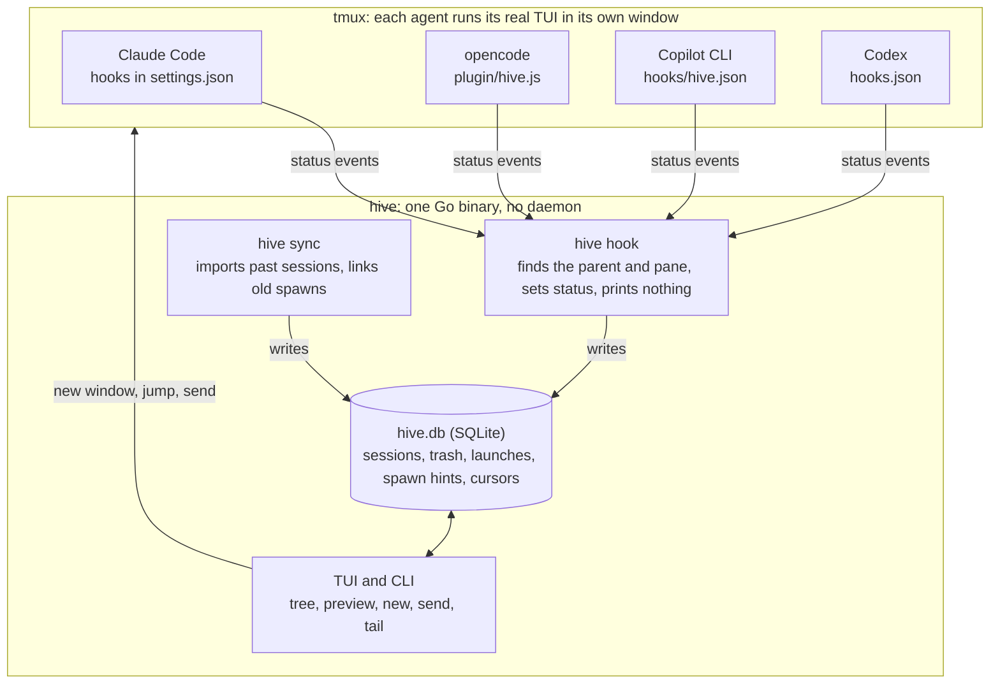

# hive — design

hive is one Go binary that records every Claude Code, opencode, GitHub Copilot CLI and
Codex session, links each agent to the agents it spawns in any direction, and lets you
jump into or command any of them from a single tree. Each agent runs its own real TUI
in a tmux window; hive never wraps or reimplements an agent.

All five build phases shipped on 28–29 September 2026. This file is the living design:
change it in the same commit as the code it describes. The [README](README.md) covers
install and daily use.

## Decisions

Settled before coding started; the Copilot adapter and the config format came later.

| Topic | Decision | Consequence |
| --- | --- | --- |
| Name | `hive` | Binary and private repo `sadrishehu/hive`; data in `~/.local/share/hive` |
| Headless children | Support both | `opencode run`, `claude -p` and `codex exec` stay tracked and watchable; `hive new` adds interactive, jumpable children |
| Host | tmux is a hard dependency | Every agent TUI lives in a tmux window; `hive` outside tmux starts or attaches a `hive` tmux session |
| Tools' own subagents | Shown by default | Claude Task agents, opencode task sessions and Codex's spawned threads appear as children; `i` hides them |
| Popup key | prefix + `a` (Ctrl+b a) | `hive install tmux --key` changes it |
| Needs-you key | prefix + `A` | `hive install tmux --next-key` changes it; it runs `hive jump --next` for the client that pressed it |
| Telling you an agent needs you | a tmux message by default; desktop notifications and the status-line count are opt-in | The hook that records the wait sends it, so there is still no daemon; `hive install` never edits `status-right`, which people style themselves |
| Waiting on agents | `hive wait` polls the database | A message hive gave an agent counts until a turn ending after it, so a `wait` right after `send` never takes the turn before for the reply |
| Spawn direction | Any tool can spawn any tool | One mechanism in the core links every direction; adapters only report |
| Codex | Built once it was installed | Tested live against Codex 0.158; Codex asks once, in an interactive session, to trust new hooks |
| Copilot CLI | Added beyond the first plan | Tracked live through user-level hooks; it has no permission hook, so it never shows "needs you" |
| Config | TOML, `[[agent]]` tables | New tools without Go code; built-in tools changed field by field |
| Deleting | A trash first, then deleting for good through each tool | Nothing is lost by one key press; what is deleted for good goes the way its tool would delete it, so the tool's own lists stay consistent |
| Picking the model | Once, at launch, from cue words in the prompt and hive's own ratings | A running agent keeps its model; a pick costs nothing and says why; config.toml corrects the ratings |

## Architecture



- hive never wraps an agent. It starts the real binary in a tmux window and gets out of the way.
- Agents report themselves. Each tool gets a small integration that calls `hive hook <tool>`;
  nothing of hive's runs in the background.
- Tools are adapters. Everything tool-specific sits behind one interface, or a few lines of
  config; linking, liveness, tmux control and the TUI are shared.

## Parent to child linking

Linking lives in the core, so every direction works the same: Claude to opencode, opencode
to Claude, Codex to Claude, and any tool added later. When a session first reports in, its
parent is the first of:

1. the parent the event names: opencode's `parentID`, Claude's and Codex's `SubagentStart`;
2. the launch record for its tmux pane: hive opened that window (`hive new`, `n` / `c` in the
   tree) with the parent it was asked for, by default the agent that ran `hive new`;
3. the nearest ancestor process that is a live session, at any depth and mix of tools;
4. `HIVE_PARENT` from the environment, which survives `nohup` and `setsid`;
5. the tool's own variable: `CLAUDE_CODE_SESSION_ID`, `CODEX_THREAD_ID`.

Ancestry comes before the environment because children inherit variables from further up:
a Claude run inside opencode inside Claude still sees the outer `CLAUDE_CODE_SESSION_ID`.
No match makes the session a root. The parent is written once and checked for cycles. A
parent named only by the environment that hive doesn't track yet is adopted from the
child's nearest ancestor running that tool, so agents started before `hive install` become
tracked as soon as they spawn something.

The same walk up the process tree finds the tmux pane; meeting another agent's process
first means the session runs inside that agent's shell tool, so it is headless. Codex runs
its hooks in its shared `codex app-server` daemon, not under the TUI: hive finds a Codex
TUI through the window it opened for it, or as the only Codex TUI in that folder.

| Tool | Reports itself | Marks its children | Past spawns found in |
| --- | --- | --- | --- |
| Claude Code | hooks in `~/.claude/settings.json` | `CLAUDE_ENV_FILE` exports `HIVE_PARENT`; `CLAUDE_CODE_SESSION_ID` | Bash tool calls in `~/.claude/projects/*/*.jsonl` |
| opencode | plugin `~/.config/opencode/plugin/hive.js` | the plugin's `shell.env` sets `HIVE_PARENT` | bash tool parts in `opencode.db` |
| Copilot CLI | hooks in `~/.copilot/hooks/hive.json` | nothing: its children link by process ancestry while it runs | shell commands in its session store and event logs |
| Codex | hooks in `~/.codex/hooks.json` | `CODEX_THREAD_ID` | shell commands in its rollouts; its own spawns in `thread_spawn_edges` |
| hive | not needed | the launch record, and `HIVE_PARENT` in the window | the `launches` table |
| Tool from config | `hive hook <name>` with JSON or flags | inherits `HIVE_PARENT`, or its own `parent_env` | none; process tree only |

**Past spawns.** `hive sync` scans every imported session's shell commands for any known
tool's binary: `opencode run --title X` inside Claude, `claude -p` inside opencode,
`codex exec` inside either. A command is matched to the session it started by title first
(loop titles like `review-p$i` become patterns and match every run), then by start time and
folder. A command continuing a session by ID (`opencode run -s ses_…`, `codex resume <id>`)
links only sessions nothing else claims.

## Adapters

A tool is an adapter: a data spec plus a few methods.

```go
type Spec struct {
	Name              string
	New, Resume       []string // commands; {prompt}, {session} (an ID hive picks), {id}
	Process           []string // program names of the tool's processes
	HelperSubcommands []string // its processes that aren't sessions (a daemon, `claude mcp`)
	Headless          []string // "-p" anywhere, or a subcommand ("run") after the program
	ParentEnv         string   // the tool's own session variable
	TitleFlags        []string // flags that title a new session, to match history
	SessionFlags      []string // flags or subcommands that pick a session to continue
	ResumeSubagents   bool     // its subagents can be reopened on their own
}

type Adapter interface {
	Spec() Spec
	ParseHook(stdin []byte, args []string, getenv func(string) string) ([]Event, error)
	Install(hiveBin string) (string, error) // idempotent; backs up what it edits
	Uninstall() (string, error)             // removes exactly what Install added
	Installed() bool
}
```

Optional interfaces add the rest: `Importer` (history for `hive sync`), `Tailer` (the
preview and `hive tail`), `ResumeChecker` (refuses reopens the tool would fail),
`Prewarmer` (sessions a tool starts ahead of use, hidden until their first message) and
`Purger` (deletes a session from the tool's own storage for good).

`Purger` uses the tool's own delete wherever there is one, and treats a session that is
already gone as deleted. Only IDs made of letters, digits, `-` and `_` reach a file path.

| Tool | Deleting a session for good |
| --- | --- |
| Claude Code | `claude rm <short id>` when `jobs/<short id>/state.json` names the session (a `claude --bg` session; it refuses while the worktree has unpushed work, and then nothing else goes); then `projects/*/<id>.jsonl`, `projects/*/<id>/`, `file-history/<id>`, `session-env/<id>`, `tasks/<id>`. A subagent: its `agent-<id>.jsonl` and `.meta.json` |
| opencode | `opencode session delete <id>`; "Session not found" counts as done |
| Copilot CLI | `session-state/<id>/`, as Copilot's own delete; then, in one transaction, its rows in every `session-store.db` table with a `session_id` column, and in `sessions` |
| Codex | `codex delete --force <id>` with `CODEX_HOME` set; a failure with no rollout left counts as done |

| | Claude Code 2.1.283 | opencode 1.18.32 | Copilot CLI 1.0.89 | Codex 0.158.0 |
| --- | --- | --- | --- | --- |
| Integration | hooks in `~/.claude/settings.json` | plugin `~/.config/opencode/plugin/hive.js` | `~/.copilot/hooks/hive.json` | `~/.codex/hooks.json` |
| Events used | SessionStart/End, UserPromptSubmit, PostToolUse, Notification, Stop, StopFailure, SubagentStart/Stop | session.created/updated/status/idle/deleted, permission.asked/replied/updated | sessionStart/End, userPromptSubmitted, pre/postToolUse, errorOccurred, agentStop, subagentStart/Stop | SessionStart/End, UserPromptSubmit, PostToolUse, PermissionRequest, Stop, Interrupt, SubagentStart/Stop |
| "Needs you" from | Notification (permission, input) | permission.asked | none | PermissionRequest |
| Own subagents | SubagentStart, plus `subagents/agent-*.jsonl` | `session.parent_id` | shown as the parent being busy | SubagentStart, plus `thread_spawn_edges` |
| Past sessions | `~/.claude/projects/*/*.jsonl` | `opencode.db`, read-only | `session-store.db` (read-only) and `session-state/*/events.jsonl` | `sessions/**/rollout-*.jsonl` and `state_N.sqlite` (read-only) |
| New | `claude --session-id {session} {prompt}` | `opencode --prompt {prompt}` | `copilot --session-id {session} --interactive {prompt}` | `codex {prompt}` |
| Resume | `claude --resume {id} {prompt}` | `opencode --session {id} --prompt {prompt}` | `copilot --resume {id} --interactive {prompt}` | `codex resume {id} {prompt}` |
| Headless marker | `-p`, `--print` | `run` | `-p`, `--prompt` | `exec`, `e`, `review` |
| Usage from | `message.usage` and `message.model` per request (once per `requestId`), `cost-state` at exit, `tool_use` blocks | `message.data` tokens and cost, `part` tool rows | `assistant.message.outputTokens`, `tool.execution_start`, `session.shutdown` totals | `token_usage_record`, `token_count` (window), `turn_context.model`, tool call items |

Claude and Copilot take a session ID at launch, so a session hive starts is in the tree
before its first hook fires. opencode and Codex choose their own; `hive new --wait` waits
for the first event, or hands back a stand-in ID (below).

**Config.** `~/.config/hive/config.toml` (`$XDG_CONFIG_HOME/hive/config.toml`; `HIVE_CONFIG`
overrides it) adds tools and changes built-in ones:

```toml
[[agent]]
name     = "aider"
new      = ["aider", "--message", "{prompt}"]
resume   = ["aider", "--restore-chat-history"]
headless = ["--message"]

[[agent]]  # a built-in tool: only the fields given change
name = "opencode"
new  = ["opencode", "-m", "deepseek/deepseek-v4-pro", "--prompt", "{prompt}"]
```

Fields: `new`, `resume`, `process` (defaults to the program `new` runs), `headless`,
`title_flags`, `session_flags`, `parent_env`. An empty placeholder drops the flag right
before it. An `[alerts]` table says how hive tells you an agent needs you: `tmux` (a
message, on by default) and `desktop` (off). An unknown key, a bad name or a duplicate
makes hive ignore the whole file, so hooks keep working and alerts keep their defaults;
`hive doctor` says what is wrong.

**Any tool can report.** `hive hook <tool>` takes JSON on stdin — `event` (start, prompt,
busy, idle, attention, end, update), `session_id`, and optionally `pid`, `parent_id`,
`title`, `cwd`, `internal`, `headless`, `at` — or the same fields as flags. A tool with no
hooks still gets launch, jump, and "untracked" nodes found by process name.

## Data model

One SQLite file, `~/.local/share/hive/hive.db`, in WAL mode with a 5 s busy timeout so hooks
from many agents can write at once. The driver is pure Go (`modernc.org/sqlite`), so there
is no cgo. Migrations run under `PRAGMA user_version`.

`sessions` — one row per session, from any tool, forever:

| Column | Meaning |
| --- | --- |
| `id` | `<tool>:<native_id>`, e.g. `opencode:ses_f18c…`; Claude subagents are `claude:<session>/<agent>` |
| `tool`, `native_id` | the adapter and the tool's own ID, used to resume |
| `parent_id` | hive ID of the parent; written once, checked for cycles |
| `kind` | interactive, headless, or internal (a tool's own subagent) |
| `status`, `status_at` | working, attention (needs you), idle or exited; the timestamp drops out-of-order events |
| `pid`, `pane` | set while live; cleared when the process is gone |
| `title`, `cwd`, `transcript`, `last_prompt` | display, preview, reopening |
| `created_at`, `updated_at`, `source` | epoch ms; source is hook, launch, import or inferred (named as a parent by a child) |

Helper tables:

- `trash` — sessions deleted from the tree, and when. Their rows stay in `sessions`, links
  and all, so restoring loses nothing; every read of the tree leaves them out.
- `purged_sessions` — IDs deleted for good, so an import can't bring one back from a copy
  a tool still keeps. Hints matching a purged session as the one a command started stay
  closed, so that command isn't matched to another session.
- `launches` — a tmux pane hive opened → tool, parent, title, folder; taken by the first
  session that reports from that pane within 10 minutes.
- `spawn_hints` — a spawn found in a past shell command: parent, time, tool, title or
  session ID, folder, and the child once matched.
- `import_state` — sync cursors: size and modification time per transcript, and
  `time_updated` for the tools' databases.
- `session_usage` — one row per session: model, per-model token counts (JSON), totals,
  the price the tool reported, the input side of the last request and the window size,
  tool and skill call counts (JSON), and the reader's cursor (byte offset plus what it
  needs to continue, as JSON) so a growing file costs only its new bytes. Only prices the
  tool reported are stored; estimates from built-in and `[[model]]` prices are computed
  when a row is read, so a config change takes effect at once. `hive sync` refreshes rows
  under a 5 s budget, live sessions first; `hive sync` from the shell drains the rest.
- `inputs` — the last message hive gave a session that its agent hasn't answered yet,
  and when: by session ID, or by tmux pane for an agent hive started with a prompt that
  hasn't named its session yet; the first event from that pane hands it over. An
  `idle`, `attention` or `end` event at or after that time answers it; `start` doesn't,
  as tools report starting up before they read their first prompt.

**Liveness.** Every 1.5 s the TUI runs one `ps` and one `tmux list-panes`, and every 30 s a
history sync. A dead pid, or a pid whose program no longer matches the tool, marks the
session exited. Internal subagents have no pid of their own; they end with their parent.
Besides the stored rows, the tree shows agent processes no session claims (untracked) and
windows hive opened whose agent hasn't reported in yet (new session). Sessions that ended
without a title, a message or children are left out, and so are live sessions a tool
started ahead of use until their first message.

## TUI

A tree on the left, a live preview on the right, built with Bubble Tea v1. It opens full
screen (`hive`) or as a tmux popup (prefix + a) that closes when you jump.

● working · ◆ needs you · ◉ idle · ◌ running or untracked · ○ exited. `run` marks a headless
session, `sub` a tool's own subagent.

| Action | Live in a tmux pane | Live but headless | Not live |
| --- | --- | --- | --- |
| Enter (jump) | switch to its pane | stay; the preview shows its output | reopen its real TUI in a new window and switch to it |
| `s` (send) | paste the text and press Enter | refused: a headless run takes no input | reopen with the text as the next message |
| `r` (resume) | same as jump | refused until it finishes | reopen in a new window |
| `x` (kill) | after you confirm: close the window hive opened, or SIGTERM under your shell | SIGTERM after you confirm | not offered |

A tool's own subagent jumps to its parent's pane; opencode subagents can also be reopened on
their own. Reopening is refused, with the reason, when the tool would fail, such as a Claude
session that ended before its first message was saved.

Other keys: `n` new agent, `c` new agent as a child of the selected one, `/` filter by
title, folder or ID (`team:<name or ID>` shows that team's whole subtree; a bare `team:`
shows every team), `a` recent or all history, `i` hide or show subagents, `S` sync now,
`y` copy the ID, `tab` hide the preview, `u` show what the session used (model, tokens,
price, context, tools, skills) in place of the pane preview, `←` / `→` collapse and expand,
`?` help, `q` quit.

**New agent.** `n` and `c` open a form: the tool, the folder (the parent's by default) and
an optional first prompt. Editing the folder lists up to eight folders that complete it:
those inside what's typed up to its last `/` whose names start with the rest, ignoring
case, with hidden ones once that starts with a dot. `↑` / `↓` highlight one; `tab` fills
it in (the first if none is) and lists the folders inside it; `enter` takes the
highlighted one and moves on, or keeps what's typed when none is; `esc` hides the list.
`~` and relative paths resolve as starting the agent does. `hive new --cwd` gets the same
from the shell's folder completion.

**Deleting.** `d` moves the selected session and everything under it to the trash, after
you confirm; the question counts every session that goes, including ones hidden by the
filter, `i` or the 24-hour view. It is refused while anything in there runs. `t` shows the
trash as a tree of its own, with the preview still working: `r` restores a session with
everything under it, `d` deletes it for good after you confirm, `t` or `esc` goes back.

**Preview.** For a session in a pane, the screen (`tmux capture-pane`); otherwise the end of
its transcript from the tool's own files, which is how you watch headless runs.

## Needs you

A session needs you while its status is `attention`: a permission prompt or a question.
Claude Code's idle reminder counts as idle, and Copilot CLI has no hook for either.

- **Alerts.** When `hive hook` records a session going into `attention` (not a repeat,
  and not an event older than what is recorded), it shows `hive: <tool> ‹title› needs
  you` with `display-message` on every tmux client whose current window isn't the
  session's (a subagent's is its parent's), and a desktop notification if `[alerts]`
  asks for one. The text is escaped for tmux, as a title could otherwise run a command
  through `#(…)`.
- **prefix + A** is `run-shell -b "hive jump --next --client '#{client_name}'"`. It
  switches that client to the session that has waited longest, by `status_at`, or, from
  one of them, to the next in that order. Output from `run-shell` would show in a pane,
  so it reports on the client's status line instead, errors included.
- **`hive status`** counts live sessions: ◆ attention, ● working, ◉ idle. Subagents
  count only when they need you, since otherwise their work is their parent's. `--tmux`
  wraps each count in style tags that undo only what they set. It refreshes liveness as
  `hive ls` does (one `ps`, one `tmux list-panes`, about 50 ms).
- The tree's header shows the same count.

## Picking the model

`hive new auto`, `--model auto`, `auto` in the new-agent form, and a team member started
with `auto` let hive choose the model for a new agent, and in provider mode the tool
too. hive reads the prompt for the kinds of work it asks for and how hard it is, then
starts the lightest model that meets that bar: an easy task doesn't spend a frontier
model, and a hard one doesn't get a fast one. The idea is Copilot's HydraFusion. The pick
happens once, at launch: hive never wraps an agent, so it can't change a running one's
model.

### Decisions

| Question | Decision |
| --- | --- |
| How a prompt is read | cue words, its length and its steps; no model call, so a pick is instant, free, and can say exactly why |
| What a model offers | a tier per model, refined by optional per-signal ratings: hive's starting ratings, not measurements, which config.toml corrects |
| What "lightest" means | the lowest total rating that meets every level the prompt asks for, then the cheaper, then the faster, then the preferred tool |
| How far a pick reaches | a mode: `provider` (the tool and the model; the default) or `model` (the model, inside one tool) |
| What a tool can run | its adapter's list, what it lists itself (opencode), and the models its past sessions used, as it reported them |

### What a prompt needs

`fusion.Assess` turns a prompt into a level from 4 to 10 for each kind of work it asks
for, with the cues that set them:

- **Four kinds of work**, each with its cue words: reasoning (design, plan, review,
  security, performance, migration…), coding (implement, add, refactor, write tests…),
  debugging (fix, crash, flaky, root cause…) and tool use (run, deploy, commit, lint…).
  The prompt is lowered to its words first, so a cue matches whole words and punctuation
  can't hide it.
- **One difficulty for the prompt**, given to every kind it shows: 6 for routine work; 8
  with a hard cue (architecture, across, every, concurrency, carefully…); 4 with a light
  cue (typo, rename, quick…) in a prompt under 40 words. A prompt over 60 words adds 1,
  and one over 150 words or with three or more steps (list items, "then") adds 2. The
  result stays between 4 and 10.
- A prompt without a cue for any kind counts as routine coding. No prompt means an open
  session, which asks for 8 on everything.

### What a model offers

- **Tiers.** Every model in the catalog has a tier, which gives it the same rating on
  each kind of work and a speed: `frontier` 10 (speed 3), `strong` 8 (5), `balanced` 6
  (7), `fast` 4 (10). A per-kind rating or a speed, 1 to 10, replaces the tier's where it
  is set. A model's power is the sum of its four ratings.
- **Built-in rows.** Claude models with their list prices; GPT, Gemini, DeepSeek, Grok
  and GLM models rated, without prices.
- **`[[model]]` rows** in config.toml lie over the built-in ones. Their prices and
  context window replace the row's, so a row without prices takes the price away; a tier
  or rating they don't set stays the built-in one, so a row written for its price keeps
  the model rated. A family row (`gpt-6`) prices the models under it that have no price
  of their own, as the built-in rated rows carry none.
- **Matching a tool's name** for a model: `Catalog.Match` drops a provider in front
  (`deepseek/deepseek-v4-pro`), a version after `@` (`claude-opus-5-5@default`) and dots
  in the version (`gpt-5.5` is `gpt-5-5`). Unlike the price lookup it takes no prefix, so
  a variant hive doesn't know stays unrated instead of borrowing a sibling's ratings.

### What a tool can run

`Tracker.ToolModels` merges, in order: the adapter's list (Claude Code, Copilot CLI and
Codex ship one; `models = [...]` in an `[[agent]]` table replaces it), what the tool lists
itself right now (`opencode models`, through `agent.ModelLister`), and, for a tool that
can't list, every model its past sessions used, from `session_usage`. Only rated models
compete, and a model a tool offers under two names (two providers in opencode) counts
once. Only a tool whose start command has a `{model}` placeholder can be given a model;
the built-in ones have it.

### The pick

- **Scope.** In `provider` mode every installed tool that takes a model competes, and
  ties go to `[fusion] tool`, else the parent session's tool. In `model` mode the models
  of one tool compete: the one named, else `[fusion] tool`, else the parent's, else the
  first installed. Naming a tool with model `auto` is always `model` mode.
- **Order.** Among the models that meet every level: the lowest power, then the cheaper
  by what a million tokens in and out cost (only when both have a price), then the
  faster, then one from the preferred tool. When none meets the bar, the smallest
  shortfall wins, then the most power, and the reason says that nothing met it.
- **The reason** names the model, how many met the bar, and the levels:
  `claude · claude-opus-5-5: the lightest of 24 that meet reasoning 8, coding 8`.
  `--dry-run` prints it with the cues; `hive new` and `hive team new` print it with what
  started, and the tree's flash names the model and the levels.
- **Team members** started with `auto` are rated on the team's goal and their own part,
  not on the brief, which is the same for everyone; one `hive team new` asks each tool
  for its models once.

`hive models [tool] [--json]` lists what each installed tool can run, with the ratings,
and which of its models are unrated. The new-agent form has a model field (the tool's
default, `auto`, or one it runs, loaded without blocking the form) and, for tool `auto`,
the mode, which ←/→ flips. `[fusion] mode` and `tool`, and the `[[model]]` ratings, are
checked when config.toml loads, like the rest of it.

## CLI

Every tree action is also a command, so agents can run agents of their own. A session is
named by its full ID, the tool's own ID, or a unique prefix of either; a name hive hasn't
seen yet triggers a history import and one retry.

| Command | What it does |
| --- | --- |
| `hive` | the tree; outside tmux it starts or attaches the `hive` tmux session |
| `hive popup` | the tree in a tmux popup; quits after a jump |
| `hive ls [--all \| --live] [--json] [--no-sync]` | print the tree; `--json` is a flat list with depth, for agents |
| `hive new <tool\|auto> [-p text] [--model name\|auto] [--mode provider\|model] [--dry-run] [--cwd dir] [--parent auto\|none\|<id>] [--wait] [--focus]` | start an agent in a background tmux window, linked under the calling agent; print its ID. `auto` [picks the model](#picking-the-model), and the tool too |
| `hive models [tool] [--json]` | what each installed tool can run, with the ratings `auto` picks by |
| `hive send <id> [text \| -]` | type into its pane and press Enter; an ended session reopens with the message |
| `hive tail <id> [-n 40] [--json]` | print the end of its transcript |
| `hive wait <id>... [--any] [--timeout d]` | block until each has answered what hive gave it and is idle, needs you, or has ended; print `<id> <idle\|attention\|exited>` as each gets there |
| `hive jump <id>` | switch to its pane (a subagent's: its parent's), reopening it if it has ended; outside tmux, attach |
| `hive jump --next` | switch to the session that has needed you longest, or from one of them to the next |
| `hive status [--tmux]` | one line counting live sessions that need you, work, or are idle; nothing when none runs |
| `hive resume <id> [-p text] [--focus]` | reopen an ended session in a background window |
| `hive kill <id>` | stop its process; a window hive opened closes with it |
| `hive rm <id>` | move it and everything under it to the trash, once all of it has ended |
| `hive trash [--json]` | list the trash |
| `hive trash restore <id>` | bring it back with everything under it |
| `hive trash purge <id> \| --all [--yes]` | delete for good, from the tools too, deepest first; asks first, and without a terminal needs `--yes` |
| `hive sync [--full]` | import past sessions and link past spawns |
| `hive install [claude\|opencode\|copilot\|codex\|tmux] [--key a] [--next-key A]` | connect tools and bind the popup and needs-you keys; idempotent, backs up first |
| `hive uninstall [...]` | remove exactly what install added |
| `hive doctor` | check hive on PATH, tmux, the popup key, the database, the config, every tool's hooks, and hook errors from the last day |
| `hive team …` | [teams](#teams): start one, follow its channel, write to its members |
| `hive hook <tool>` | for integrations only; prints nothing, always exits 0 |

**Interactive children from inside an agent.** Claude runs
`hive new opencode -p "port the tests" --wait` and gets back an ID; the opencode TUI opens
in its own window, linked under that Claude session, and Claude uses `hive send` and
`hive tail` on it while you can jump in at any time. `--wait` returns once the agent has
reported in, so a `send` right after it isn't typed before the agent can read it. A tool
that starts its session only with its first message (opencode without a prompt) gets a
stand-in ID after 10 s of silence, `opencode:pid-N`, which every command accepts and which
names the real session once it starts. `hive wait` then blocks until the child is done
with what it was given; the `inputs` table keeps it from returning on the idle a tool
reports as it starts up, or on the end of the turn before a `send`.

## Teams

A team is a few agents working on one goal in one folder, and a channel where they report
to you. Each member is a real session in its own tmux window, started with its tool's own
command; `hive send`, `tail`, `wait`, jump, stop and the trash work on it as on any
session. hive holds what the team shares: who is on it, the goal, the task board, the channel
and the messages between members. Nothing new runs in the background: hooks, `hive team …`
commands and the tree's refresh drive it all.

Only two things enter a member's session: its brief, typed as the first prompt, and
messages from teammates, typed into its pane. Only two leave it: the `hive team …`
commands it runs and its hook events. The agents stay native; the team lives in hive's
database and the tree.

The whole plan is built: teams, the channel and the mailbox; the task board; worktrees
and `hive team done`; the trash, mute, `hive team new --wait` and the live test; config
templates and the new-team form; the task editor; the full-screen channel; and the team
filter and demo.

### Decisions

| Question | Decision |
| --- | --- |
| How members are addressed | by role (`lead`, `backend`, …), not session: mail follows a member reopened under a new session |
| A message to a working member | waits for its `idle` hook, then is typed with everything else queued as one paste |
| Who delivers | the sender's process when the recipient is idle, else a detached `hive team deliver` that the recipient's hook starts. No daemon |
| Who leads | an agent hive starts, by default. You can step in at any point: write to anyone, take over the lead (`L`, `hive team lead`), or pause the team |
| How you follow progress | a channel: members and hive post, you answer in the same feed. A post reaches a pane only when it names a member |
| How work is split | numbered tasks with an owner and the tasks each waits for. hive tells an owner when its task is ready, so nobody polls |
| Where members work | one shared folder by default. `--worktrees` gives each member a worktree and branch of its own; the lead stays in the folder and merges |
| When a team is done | when someone runs `hive team done`, you by default: the lead posts that the goal is met. The team takes no more mail, members or tasks, and done stops nobody |
| Channel view | the feed in the preview pane; `↵` on a team opens it full screen with a live input line |

### Members and roles

- **Who leads.** `--lead tool[:model]` starts an agent as `lead` (claude by default),
  `--lead self` makes the agent running `hive team new` the lead without starting
  another, and `--lead none` leaves it to you. `L` and `hive team lead` move it at any
  time; retiring the lead hands it to you.
- **Starting.** hive starts each member through the usual launch, detached, with the
  brief as its first prompt and `HIVE_TEAM` and `HIVE_ROLE` in its window's environment,
  next to `HIVE_PARENT`. Members start in the order given, the lead first. A member
  started with `auto` gets its pick from the goal and its own part, not from the brief;
  one `hive team new` asks each tool what it runs only once. A failed member stays on
  the team with the error in the channel; if no member's window opens, the team isn't
  kept. `--wait` returns once each member has reported its session, so the roster it
  prints names them for `hive send` and the like. Until it reports, `hive team stop` and
  `hive team rm` end the window it was started in, so a pane-only member can be stopped.
- **Linking.** `launch_teams` records the pane hive opened for a role; the first session
  that reports from that pane within 10 minutes takes the role, as with a launch record.
  Older records are dropped, since pane IDs start over when tmux restarts. Claude and
  Copilot are linked at once, since hive gives them their session IDs.
- **The role follows the member** when hive reopens it (a new pane record), when it
  continues under a new session ID (Codex, opencode), and when its process starts a new
  session (`/clear` in Claude, `/new` in opencode). For `/clear`, the ended session leaves
  a record naming its process, so only that process's next session in that pane takes
  the role, whichever of the two hooks arrives first.
- **Several teams.** A session can play a role on more than one team: an agent on one
  can lead another of its own with `--lead self`. Its mail from all of them arrives in
  one paste, and a command it runs without naming a team asks which.
- **Who is calling.** A `hive team` command finds its member, in order: the nearest
  session up the process tree, or up the parent links from it, that plays a role, so a
  member's subagent or child speaks for it; the role `HIVE_TEAM` and `HIVE_ROLE` name;
  the nearest up the parent links from the session `HIVE_PARENT` names. The process tree
  comes first because `HIVE_PARENT` in a member's window names the agent that made the
  team. A message is from the caller's role; from `you` only outside any agent; and from
  an agent that isn't on the team, as its session ID (or `team/role` for a member of
  another team), so an agent is never taken for you. `--as` sets it for scripts.

### Templates

A `[[team]]` table in config.toml saves a roster and its goal, and `hive team new --from`
starts a team from it. The template supplies the goal, lead, folder, worktrees and
members; a flag passed on the command line wins, and `--member` adds to the template's
members, so a saved roster can take one more reviewer for a particular run. The positional
name is always the new team's, and `self` isn't allowed as a template lead: no agent runs
the command then.

```toml
[[team]]
name      = "api"          # looked up by --from
goal      = "add the admin API"
lead      = "claude"       # a tool[:model], or "none"
cwd       = "~/src/app"    # optional; default: where you run the command
worktrees = true

[[team.member]]
role   = "backend"
tool   = "claude"
model  = "auto"
prompt = "handlers"
```

The template's name is unique and follows a team name's rules; every member's role is a
valid role and appears once, including the lead's; and a member names a tool. The folder is
stored absolute, so a relative `cwd` resolves where `hive team new` runs. A broken config
changes nothing, as everywhere else.

### The brief

The first prompt of each member, and the one place hive talks to an agent: the team,
its roster and folder, the goal, the member's own part, how to use `hive team board`,
`task claim`, `done` and `block`, `post`, `say` and `log`, and that hive wakes it when
someone writes to it or a task of its own is ready. The lead is told to turn the goal into
tasks with owners and `--after`, then review what is marked done, integrate and post when
the goal is met. When you lead, every member is told so, including one whose role
happens to be called `lead`: who leads goes by the team's lead role alone.

### The channel and the mailbox

- **Posts.** `hive team post` writes to the channel, which you read in the team node's
  preview or full screen. A post reaches a pane only when it names a teammate with
  `@role`, a whole role: `@dev` isn't in `@dev-ops`. Otherwise every update would
  interrupt every agent.
- **hive's posts.** A member started, needs you, stopped, continues as another session or
  left; the team paused or resumed; who leads. They come from hooks and commands, so they
  cost no tokens, and the feed has news even when an agent forgets to post. `m` hides
  them.
- **Messages.** `hive team say <role|all>` writes to teammates; `all` leaves the sender
  out, and a member can't write to itself. `--private` keeps one out of the feed you read
  (`board`, `log` and the tree); `inbox` still reads it. What you write with `s` in the
  tree, or on the channel's live line, goes through the same mailbox.
- **Unread.** `team_reads` keeps the last message you have seen per team; the node shows
  what others wrote since.

**Delivery rules**, per recipient, in order:

| Recipient is | hive does |
| --- | --- |
| on a paused team | queues it; `resume` delivers what waited. `inbox` leaves it too |
| muted with `hive team mute` | queues it; `unmute` delivers what waited. `inbox` still reads it |
| idle, in a pane | types it now, from the sender's process, and records it in `inputs` so `hive wait` waits for the answer |
| working | queues it. Its `idle` hook starts `hive team deliver` detached, which waits a second for the TUI to settle, looks again at the member, its teams and its status, then types everything queued as one paste |
| waiting on you | queues it: typing into a permission prompt would answer it |
| of unknown status, in a pane (a tool without turn hooks) | types it now, and says the delivery was blind |
| exited | reopens it with the queued messages as its next prompt, as `hive send` does |
| not reported in yet | queues it; its `start` hook delivers |
| retired with `hive team rm` | gets nothing: its queue is dropped, and nothing more is addressed to it |

The sender's process and the hook's can deliver at once, so a delivery claims the queued
rows in one `UPDATE … RETURNING` before it types, and gives them back if typing fails.
`hive hook` never waits on a delivery, so the agent's hook timeout is never at risk and
nothing prints into the agent. An agent that would rather read its mail runs
`hive team inbox [--wait]`.

**The envelope.** Every delivered line is `[team · from role] text`, with line breaks and
every other control character turned into spaces. Starting with `[`, a line can't run a
slash command (`/exit`), a shell escape (`!`) or a memory shortcut (`#`) in the
recipient's TUI; holding no escape, it can't end tmux's bracketed paste early and reach
the TUI as keys. Several messages go as one paste, one line each, with one Enter. Text hive
draws in the board, the channel and the tree has other control characters stripped too, so a
teammate can't paint the user's terminal.

### The task board

- **Tasks.** `hive team task add` puts a task on the board under the team's next number
  (#1, #2, …), with a title, details (`--body`), an owner (a role) and the tasks it waits
  for (`--after 1,2`). It can wait only for tasks already on the board, so tasks never wait
  for each other in a ring. A task is open, claimed, done or blocked; its note says what
  done changed, or why it is blocked. A done team takes no new tasks.
- **Claiming.** `claim <n>` makes a task the caller's. It is refused, with the reason,
  for a task that waits for one that isn't done (naming them), that is another member's
  or claimed by one, and on a paused or done team; `--force` overrides all but the pause,
  a done team and a task that is done. Taking one over with `--force` is news to the member
  that held it. Only a
  member claims (`--as role` for scripts). Two claims at once can't both win: a move
  applies only over the task as it was read, and the loser is told who has it.
- **Closing.** `done <n> [--note]` and `block <n> --why` are posted by hive. When an agent
  leads and didn't make the change, the post is addressed to the lead, so it is typed into
  the lead's pane at idle like any message. `done` lists the tasks it made ready: open
  ones that waited for it and for nothing else left. hive tells each one's owner, through
  the mailbox and out of your feed, since the post already names them: `#5 admin table
  view is yours, and ready (#4 done by backend: …). hive team task claim 5 takes it.` A
  task added with an owner and nothing left to wait for is told at once. Whoever closed a
  task reads what became ready in the command's output instead. On a done team a task can
  still be closed, but that adds no post or mail.
- **Waiting.** `hive team wait` looks at the board twice a second, as `hive wait` does,
  and prints what happened: a task as hive words it, a message in its envelope. With no
  flag it returns when any task is done or blocked, or mail comes for the caller; `--task
  n` when that task is done or blocked (at once if it is); `--from role` on mail from that
  role; `--any` also on a task added or claimed and on anything written in the channel
  but hive's own posts. Mail it prints is marked delivered, as `inbox` does, so it isn't
  typed again; a paused team keeps it. When hive's mail says what a task's line would,
  only the mail is printed. A caller off the team, like you in a shell, reads the channel.
- **Reading it.** `board` lists the tasks, and with each member the task it holds; `task
  ls` adds the details; `ls` counts them. In JSON each task has `ready` and `waits`.
- **Editing it from the tree.** `e` on a team opens its board full screen: every task
  with its status, owner and what it waits for, and the selected task's body and note
  under the list. `j`/`k` move, `n` adds a task, `e` or `↵` edits the selected one, `d`
  marks it done with an optional note, `b` marks it blocked with a required why, and
  `esc` goes back to the tree, or from a form back to the board. The user acts as `you`
  on the API: the owner must be a role on the team, and `after` must name tasks already
  on the board, as when one is added. An edit also can't make a task wait on itself through
  a cycle, and clearing the owner of a claimed task reopens it. An edit is applied over the
  task as it was read, and loses, naming who has it, when someone moved it meanwhile.

### In the tree

A team is a node of its own (`⬡`): at the root, or under the session that made it unless
that session is on the team. Its members sit under it, and a member's own children stay
under the member. The node takes the most urgent status of its live members, and counts
tasks done. Its preview is the board and the channel, under a strip of the members; the
board takes at most half, folding the done tasks first. A member's row is titled by the
task it holds (`backend · #4 handlers…`), else by what its session does.

`↵` on a team opens its channel full screen: the team's name, goal, roster and state, the
task board and the feed, with a live line at the bottom. Typing writes to everyone
(`@role` for one), `↵` sends through the same mailbox as `s`, `esc` goes back to the tree,
and the prompt wraps: `↑/↓` move the caret once typing, and `pgup`/`pgdn` (or `ctrl+u`/
`ctrl+d`) scroll the feed. The channel marks its team read while it is open, preview or
no preview.

| Key, on a team | Does |
| --- | --- |
| `↵` | open the team's channel full screen; on a member row, jump to that member |
| `e` | open the board editor: `n` adds, `e`/`↵` edits, `d` done, `b` blocked, `esc` back |
| `s` | write to everyone (`@role` for one); on a member, to that member |
| `p` · `L` · `m` | pause or resume · take the lead or hand it back · hide hive's posts |
| `x` | stop every member that runs (asks first) |
| `d` · `t` | move the team and its members to the trash (asks first, refused while a member runs) · show the trash |
| `T` | start a team: a template to fill it, name, folder, work (the shared folder or a worktree per member), lead, a row per member (role, tool, model, its part), goal; `+` adds a row and `ctrl+d` removes one |

A done team is folded the first time the tree shows it done, and dimmed, with `✓ done`
on its row; unfolded, it stays so. Its channel stays, and `s` on it says it is done.

### Worktrees

`hive team new --worktrees`, or the form's work row, gives each member a git worktree of
its own, on the branch `hive/<team>/<role>`, under `<data dir>/worktrees/<team>/<role>`
(`~/.local/share/hive` unless `HIVE_HOME` or `XDG_DATA_HOME` says otherwise). Each is made
from the team folder's HEAD as the member starts, so one added later with `hive team add`
starts from what has been merged by then. When the team's folder is a subfolder of its
repository, the member starts in the same subfolder of its worktree. `team_members.cwd`
records where each member works, and the brief names it.

- **Checked first.** Before anything is recorded or started: git is on PATH, the folder is
  in a repository with a commit, and git takes the team's name in a branch name. A name
  like `a..b`, valid for a team, isn't valid for git.
- **The lead works in the team's folder**, on the branch it has. The members' branches are
  in the same repository, so it merges them there (`git merge hive/<team>/<role>`), and
  the result lands on the branch you had, with no last merge left for you. A lead in a
  worktree of its own would merge into `hive/<team>/lead`, which someone would still have
  to merge. Who leads is settled as members start: handing the lead to a member later
  moves nobody's folder. When you lead, every member gets a worktree, and you merge.
- **Only what hive made.** A folder or a branch already at a member's place fails that
  member, with the reason in the channel, rather than taking someone's work; it may be
  left from an older team of the same name. A member retired and added again gets its
  worktree back, with what it left there. A team that isn't kept (no member's window
  opened) takes the worktrees and branches it made with it, so the name can be tried again.
- **The brief.** A member is told its branch, to commit small and before it says a part is
  done, and that the lead merges it; the lead, the branches to merge. Changes not committed
  in the team's folder aren't in the worktrees, and hive's first post says so.

### Done

`hive team done <team>` marks the goal met: the status turns `done`, hive posts who did
it, and the mail still queued is dropped. Messages, posts, new members and new tasks are
refused from then on ("api is done; it takes no more messages, members or tasks"), from the
shell, from a member and from the tree. A task already on the board can still be closed,
but that adds no post or mail. Running it again does nothing more, but cleans with `--clean`.

- **It stops nobody.** The agent that runs it may well be the lead, which stopping every
  member would end mid-command; stopping is `hive team stop`'s, which asks first. done
  says who still runs.
- **The lead isn't told to run it.** Its brief says to post when the goal is met; you
  decide, since a done team can't be reopened yet.
- **`--clean`** compares each branch with the branch the team's folder had when the team
  started (`team_bases`), or, when its HEAD was detached then, with the folder's HEAD
  now. A worktree goes, with its branch, when its branch has no commit that one lacks,
  nothing in it is uncommitted, and its member doesn't run; `git worktree remove` runs
  without `--force`. Anything else stays, with the reason: commits to merge (a squash
  merge looks unmerged, and stays), changes not committed, a member still running, or
  what git said. `hive team board` lists what stays under "worktrees", and `done --clean`
  again takes what has been dealt with since. The team's folder of worktrees goes once
  empty.

### The trash

`d` on a team moves it, and the sessions of its members, to the trash together; `t` shows
the trash, where a team keeps its members under it. `r` restores the team, its members and
their sessions; `d` deletes them for good, each member's session through its tool, as a
session is. A team with a member running isn't trashed. A member's session that still
plays a role on a team out of the trash stays, so one agent on two teams isn't taken from
the other; the team and its role go to the trash, and the session does not.

### Data

Tables in migrations that can run twice, as the trash's can:

- `teams` — ID (8 hex), name (unique), goal, folder, workspace (`shared` or `worktrees`),
  the session that made it, status (active or done), paused, the lead's role (empty when
  you lead), and times.
- `team_members` — team and role, the session playing it now, tool, model, the member's
  own part of the brief, folder, the pane it was last started in, and when it joined and
  left. A retired member keeps its row and its messages.
- `team_messages` — team, from (a role, `you`, `hive`, or an agent off the team), to (a
  role, `all`, or nobody for a post), body, kind (post, say or system), private, time.
- `team_deliveries` — a message queued for a role, and when it was delivered.
- `launch_teams` — a pane, the team and role it was opened for, the process when the
  record hands a role on after `/clear`, and when it was made.
- `team_reads` — per team, the last message you have seen.
- `team_tasks` — team and number (from 1 per team), title, body, status (open, claimed,
  done or blocked), owner (a role), the tasks it waits for (JSON), a note on what done
  changed or why it is blocked, who added it, and times. In a migration of its own.
- `team_bases` — per worktrees team, the branch its folder had when it started (empty when
  HEAD was detached) and the commit: what `done --clean` compares with.
- `team_worktrees` — team and role, the worktree's path and branch: the worktrees hive
  made, and the only ones it removes. Removing one drops its row.
- `team_mutes` — a team and a role whose mail waits to be delivered by hand, and when it
  was muted.
- `team_trash` — a team in the trash, and when it went.

## Edge cases and safety

| Case | Handling |
| --- | --- |
| Hook output leaking into an agent | `hive hook` prints nothing (Claude adds SessionStart output to its context), always exits 0, and logs errors to `~/.local/share/hive/hive.log` |
| Events arriving out of order | each carries a timestamp; an older status never overwrites a newer one |
| `/clear` in Claude, `/new` in opencode | a new top-level session in the same process ends the previous one, and takes the roles it played on teams |
| Reused pids | liveness also checks that the process's program matches the tool |
| Detached children (`nohup`, `setsid`) | the process tree breaks, so `HIVE_PARENT` from the environment links them |
| Reopening a session that is still running | refused, so two processes never write one session |
| Hooks installed while agents run | Claude reloads hooks from `settings.json` at once; the other tools load them at start, and until then their sessions show as untracked or are adopted when they spawn something |
| Editing a tool's config | install edits in place with formatting kept, saves a `.bak-hive` copy first, and is safe to rerun |
| An agent exits with an error in a window hive opened | the window shows "stopped with an error, press Enter to close" instead of tmux's dead pane, which takes no keys; a clean exit closes the window |
| A Claude session that was never saved | reopening is refused with the reason; `claude --resume` would fail |
| Claude's daemon (`claude --bg`) | the daemon, its hosts and Claude's management subcommands are never sessions; the spares it keeps started stay hidden until their first message |
| A tool that starts its session late | `hive new --wait` returns the stand-in ID `<tool>:pid-N` |
| Codex hooks not yet trusted | Codex skips them, even in `codex exec`, until they are accepted once in an interactive `codex` |
| Two Codex TUIs in one folder | Codex's hooks run in its daemon, so hive matches a TUI it didn't open only when it is the only one in its folder; until one ends, neither gets a pane |
| A config file with mistakes | ignored whole; `hive doctor` reports it |
| A session in the trash reports in | a hook event or hive starting it takes it out of the trash, and a session deleted for good is recorded again; an import, a late end event or a child naming it as parent doesn't |
| A tool fails to delete a session | deleting stops there: what went already is gone from hive too, and the rest stays in the trash with the error shown |
| An older hive opens the database | it sets the schema version back; every migration since the trash can run again, and a newer version is never lowered |
| A message that starts no turn (`/help` sent with `hive send`) | no event answers it, so `hive wait` waits for the agent's next turn, or until `--timeout`; what the tree shows is unaffected |
| A message sent while the agent is busy | the end of the current turn answers it; a tool that queues it for the next turn is working again by the next look, so `wait` goes on, unless that look falls in the moment between |
| Two Codex TUIs in one folder, started with a prompt | neither gets a pane, so the prompt hive gave one stays on its pane and `wait` can return on the idle Codex reports at start |

## Repo layout

Module `github.com/sadrishehu/hive`, Go 1.27. Dependencies: Bubble Tea, Bubbles and Lip Gloss
v1, cobra, `modernc.org/sqlite`, `tidwall/gjson` and `sjson` for JSON read and in-place
edits, and `BurntSushi/toml`.

```text
main.go
internal/
  agent/        Spec, Event, the adapter interfaces, the generic JSON hook
    agenttest/  fake tools on PATH, for adapter tests
    claude/     hooks, transcript import, preview, resume check, daemon spares, delete
    opencode/   plugin (hive.js), opencode.db import, preview, delete
    copilot/    user-level hooks, session store import, preview, delete
    codex/      hooks.json, rollout and state DB import, preview, delete
  adapters/     the built-in adapters, with config.toml applied
  tracker/      linking, liveness, sync, launch/resume/send/stop, trash and purge, lookup, who needs you, wait, teams
  store/        SQLite: sessions, trash, launches, spawn hints, import state, inputs, teams
  team/         the rules of teams that need no database: roles, the brief, the envelope, when to deliver
  fusion/       what a prompt needs, and the pick
  usage/        token counts and prices, the model catalog and its ratings
  spawn/        finds agent commands in shell history
  proc/         the process table
  tmux/         windows, panes, paste, capture, messages, the key bindings
  tree/         the session tree and its filters
  tui/          the tree UI, team nodes and the channel
  cmd/          the commands
  paths/        data, log and config locations
```

## Build history

| Phase | What shipped | Commits | Date |
| --- | --- | --- | --- |
| 1. Tracking | store, process table, tmux helpers, Claude and opencode adapters, `hook`, `install`, `ls` | `0d74031` | 28 Sep |
| 2. History | `sync`: transcript and `opencode.db` import, past spawns linked in every direction | `eff5090` | 28 Sep |
| 3. Tree UI | tree, preview, jump, send, new, resume, kill, filter, popup; no dead panes | `7d5581d`, `e31e8bf` | 28 Sep |
| — Copilot CLI | adapter; hook format checked against the installed CLI | `bf96b7c` | 28 Sep |
| 5. Codex | adapter, non-session subcommands | `56aad41`, `37429d6` | 29 Sep |
| 4. Agent-facing CLI | `new --wait`, `send`, `tail`, `jump`, `resume`, `kill`, config, `doctor`, stand-in IDs | `e1ecb80`, `eabdbf3` | 29 Sep |
| — Claude daemon | spares and helper processes hidden | `ef8beea` | 29 Sep |
| — Deleting | trash (`d`, `hive rm`), restore, deleting for good through each tool | PR #3 | 29 Sep |
| — Folder suggestions | the new-agent form lists folders as you type; `hive new --cwd` completes them | PR #4 | 30 Sep |
| — Needs you, and waiting | tmux and desktop alerts, prefix + A and `hive jump --next`, `hive status`, `hive wait` | PR #13 | 2 Oct |
| — Picking the model | `hive new auto`, `--model auto`, `hive models`, tiers and ratings | PR #15 | 6 Oct |
| — Teams | teams, the channel and mailbox, task board, worktrees and done, trash, mute, templates, member-row form, task editor, full-screen channel, team filter, demo | PR #17 (with #18–#26) | 31 Oct |

## Testing

- Unit tests cover each package. Linking runs against a fake world (process table, panes,
  environment, clock); hook parsing uses recorded payloads; installs round-trip in temporary
  config folders; importers read fixtures shaped like the real files; the TUI model is driven
  through a fake of its operations. Team delivery runs against the same fake world, with
  the pane typing (`Tracker.Type`, `HasPane`) replaced, so a test sees what would be typed
  where.
- tmux tests use a private server (`tmux -L hive-test-<pid>`) with `TMUX` unset. Every tmux
  command in a test names its server: `$TMUX` beats `TMUX_TMPDIR`, and a bare `kill-server`
  once closed every window the user had.
- Live tests run hive with `HIVE_HOME` (a scratch database), `HIVE_CONFIG` and
  `HIVE_TMUX_SOCKET` (a private tmux server), with `HIVE_PARENT` and `CLAUDE_CODE_SESSION_ID`
  unset so test agents don't report into the real database. A fake agent — a small program
  that reports through `hive hook` and echoes what is typed — exercises `new`, `send` and
  `kill` without spending anything; real opencode on a free model covered `new --wait`; Copilot
  and Codex were smoke-tested against scratch data. Deleting for good ran with the real
  `opencode`, `codex` and `claude` binaries against copies of their data in scratch homes
  (`XDG_DATA_HOME`, `CODEX_HOME`, `CLAUDE_CONFIG_DIR`, `COPILOT_HOME`), never the real ones.
- The README's demo is recorded the same way: `docs/demo/record.sh` runs stand-in agents
  (`docs/demo/agent`) that report through `hive hook`, with a config that gives the
  built-in tools their process names, a scratch `HOME` and a private tmux server. It
  starts a small team in that scratch database before the tree attaches, with a board
  and a channel the tape opens, then replays `docs/demo.tape` with vhs.
- A claim about a tool (hook format, event names, flags) is checked against the installed
  binary, not its docs: the first Copilot adapter guessed its hook format wrong, which only
  that check caught.
